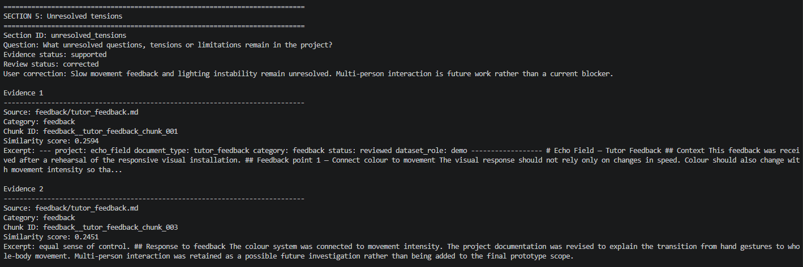

# ProjectOS

**A source-grounded, correctable brief for returning to a creative project.**

ProjectOS is an MSc research prototype that helps creative students revisit a project after an interruption. It retrieves evidence from existing project records and organises it into a six-section Project Re-entry Brief, with short AI-generated summaries and visible supporting excerpts. Users can inspect the evidence and confirm, correct or reject reconstructed project states. The local Streamlit prototype now supports researcher-assigned projects, with Echo Field as a short tutorial. Researchers prepare summaries before a session by sending selected excerpts to the OpenAI API; participant review reads the prepared summaries without calling the API.

## Guide for supervisor review

**Meeting 3 preparation: 15 October 2026, 15:00 (Europe/London). Updated following feedback on 9 October 2026.** Supervisor confirmation received on 9 October 2026: no amendment to the existing ethics approval is required. Participant-facing documents must clearly state what data will be stored, where it will be stored, and for how long.

Participant data-storage wording has been added to the information sheet and consent form. Their status is **Draft for supervisor review — existing ethics approval unchanged; data-storage wording updated following supervisor feedback on 9 October 2026.** Documents remain subject to wording review at Meeting 3. **Formal recruitment and P01 have not started.** This records supervisor confirmation about the existing approval, not a new ethics approval.

The prototype supports local, assigned-project rehearsals. In the [P00 pilot](project_knowledge/feedback/user_testing/iteration_1/pilot_p00_summary.md), the participant completed all tasks without technical errors but found the interface complex and the instructions unclear. This motivated the progressive review interface. Technical exploration is frozen for Round 1 preparation. The proposed study involves three adults returning to their own paused creative projects. P00 is excluded from the formal sample, and one pilot does not establish research conclusions. The documents below can be reviewed without installing the application or supplying an API key.

| Review question | Suggested reading |
| --- | --- |
| What is the research trying to establish? | [Current goals](project_knowledge/current_state/goals.md) and [research questions](project_knowledge/feedback/user_testing/iteration_1/research_questions.md) |
| Why this interaction, and how was it built? | [Summary design decision](project_knowledge/decisions/design_decisions/dd_004_user_facing_reentry_summary.md) and [implementation chapter draft](report/drafts/04_design_and_implementation.md) |
| What evidence exists so far? | [Retrieval baseline](outputs/test_results/day_03_retrieval_results.md), [brief evaluation and limitations](outputs/test_results/day_04_reentry_brief_results.md) and [latest development log](project_knowledge/process/daily_logs/day_8_user_research_preparation.md) |
| How will it be evaluated with people? | [Round 1 protocol draft](project_knowledge/feedback/user_testing/iteration_1/study_protocol_round_1_draft.md), [materials gap check](project_knowledge/feedback/user_testing/iteration_1/study_materials_gap_check_round_1.md), and [project-pack guide](project_knowledge/feedback/user_testing/iteration_1/participant_project_pack_guide.md) |
| What still needs attention? | [Open issues](project_knowledge/current_state/blockers.md) and [proposed next steps](project_knowledge/current_state/next_steps.md) |

The implementation chapter describes Iteration 0. Later summary generation and participant-session work are documented in the [Day 7](project_knowledge/process/daily_logs/day_7_llm_reentry_summary.md) and Day 8 logs; the chapter has not yet been extended to cover those changes.

## Problem and motivation

Creative projects accumulate goals, experiments, feedback, abandoned ideas and decisions across many files. Returning after a break involves more than finding a document: the practitioner needs to reconstruct what changed, which direction is current, what remains unresolved and what to do next. Relevant text can describe an earlier stage of the project, so retrieving a similar passage does not by itself establish the current state.

## Research focus

> How do source visibility and user correction help creative practitioners assess an AI-generated reconstruction of a long-term project during project re-entry?

The research examines source visibility, evidence absence, correction, control and verification effort. [TD-003](project_knowledge/decisions/technical_decisions/td_003_freeze_automatic_project_state_inference.md) freezes further automatic retrieval expansion after engineering success did not establish semantic acceptance. Automatic temporal reasoning, automatic contradiction detection, self-service upload, public deployment, user accounts and perfect reconstruction accuracy are outside the present scope. Explicit temporal metadata remains possible post-study interface work or future work.

## Relationship to general-purpose AI chat tools

ProjectOS uses a fixed project re-entry workflow rather than an open-ended conversation. Its design brings together six recurring project questions, source excerpts and a persistent review history. Corrections appear as the user's current understanding while the original records remain available. These are the prototype's design priorities, not a claim that general-purpose AI tools cannot support similar tasks or that ProjectOS has demonstrated superior performance.

## Current prototype workflow

1. The researcher validates the assigned project, prepares all six summaries and starts a local study server bound to one participant code. The participant enters that code and reads the study introduction.
2. Complete one Echo Field tutorial section: read a summary, open source evidence and try a response. Tutorial responses are not saved as formal reviews and never enter completion statistics.
3. Check the assigned project's readiness, then choose **Start my project review**. The first review follows the six sections in order, one at a time: each section's question, provisional summary, optional source evidence and response controls. Each section uses up to two evidence excerpts; missing categories may produce an insufficient-evidence summary.
4. Choose **Looks accurate**, **I want to update it** or **This is not supported**. An update requires correction text. Older-direction marking is available within the evidence area. Reviews and annotations do not change the prepared system summaries.
5. **Save and continue** records the response and opens the next pending section. Previous/Next allow navigation; unsaved edits must be saved or explicitly discarded first. Saved sections and remaining work are marked.
6. After all six sections have saved reviews, the completion page shows reviewed, corrected and rejected counts and **Review or change a section**. Six buttons show each section's full name and saved status; selecting one opens that section directly. These shortcuts are unavailable until all six sections have been reviewed.

Post-completion editing shows **Editing section X of 6**, with **Previous section**, **Next section** and **Back to completion summary**. Navigation stays within sections 1–6. Unsaved action, correction or note changes block navigation until the user chooses **Stay and save** or **Discard changes and continue**. Saving appends a review event, updates the status and completion counts, and keeps the current section open. The user can return to completion, continue editing or choose another section; existing summaries and evidence remain unchanged.

After a completed session is refreshed or reopened with the same participant code, it returns directly to the completion page without repeating the introduction, tutorial or readiness steps. Navigation, saving and refresh recovery read existing prepared summaries, evidence and saved reviews; they do not call the OpenAI API, regenerate summaries or rebuild embeddings.

Development mode retains the full six-section view, regeneration controls and technical information. The start screen's 10–15 minute estimate refers to the review activity only, not the full study session, and still needs validation through a timed rehearsal.

There is no project picker, file-upload interface, account system or unrestricted chat. The researcher starts a separate session for each participant. Its server accepts only the bound code and hides Development mode, so changing the entered code cannot select another project. Codes are not passwords: this is supervised, loopback-only use on the researcher's computer, not an authenticated multi-user service.

### Six Re-entry Brief sections

| Section | Purpose |
| --- | --- |
| Current intention | Reconstruct the project's current aim. |
| What changed and why | Revisit documented changes and their reasons. |
| Current versus superseded directions | Separate the present direction from earlier approaches. |
| Relevant feedback | Recall feedback and any documented response. |
| Unresolved tensions | Identify questions or limitations that may still need attention. |
| Possible next action | Surface a documented next step for the user to assess. |

## Evidence retrieval and user review

The loader supports Markdown, UTF-8 text and text-based PDFs. It retains relative source paths, file types and directory categories. Documents are split into overlapping chunks of up to 120 whitespace-separated words, with a 30-word overlap. The demonstration archive currently produces 12 chunks from four Markdown documents.

Sentence Transformers creates normalised `all-MiniLM-L6-v2` embeddings. Retrieval uses NumPy similarity ranking, section-specific queries, category filtering and chunk deduplication. Each brief section contains at most two evidence items. The LLM returns a structured summary, support status, project-state classification, source numbers and an assessment note; local validation checks the output structure and source-number bounds.

**Semantic similarity is not factual confidence. Generated summaries are provisional.** A valid citation number does not prove that the interpretation is correct. The retrieval layer's `supported` flag means evidence items were selected; it is separate from the LLM's assessment and from the user's review.

Review events support `confirm`, `correct`, `reject` and `mark_superseded`. They are appended to a local JSON history without rewriting source documents. User corrections are displayed separately from the generated interpretation. Development and participant histories live under `data/reviews/`, which is excluded from Git.

## Current features

- Local document loading, overlapping chunks and semantic retrieval.
- Six structured sections with inspectable source excerpts.
- OpenAI summary generation with Pydantic structured output and insufficient-evidence handling.
- Streamlit controls for confirmation, correction, rejection and older-evidence marking.
- A validated runtime project context, local assignments, and separate review files keyed by participant code and project ID; the existing review JSON schema is unchanged.
- A single-section Echo Field tutorial followed by assigned-project readiness, progressive review and draft protection; completion unlocks six named section shortcuts and editing with saved-state recovery.
- Researcher CLI commands for validation, preparation and a session bound to one participant.
- Private, durable summary caches checked against project, source content, evidence, model and prompt/schema fingerprints. Participant navigation and saving make no API calls; valid caches work without an API key.
- Unit tests, a small retrieval evaluation set, design decisions and draft study materials.

## Technology stack

Python 3.11 is the tested environment. Direct dependencies are pinned in [requirements.txt](requirements.txt).

| Component | Library |
| --- | --- |
| Interface and application state | Streamlit |
| Local embeddings | Sentence Transformers |
| Similarity calculations | NumPy |
| PDF text extraction | pypdf |
| Summary API client | OpenAI Python SDK |
| Structured summary schema | Pydantic |
| Automated tests | pytest |

The prototype does not require a vector database or a separate web backend.

## Repository structure

```text
ProjectOS/
├── src/                      # Retrieval, brief, summary, review and UI modules
├── tests/                    # Unit tests and retrieval evaluation questions
├── config/                   # Safe assignment example and empty category template
├── data/
│   ├── demo_projects/        # Prepared Echo Field tutorial records
│   ├── study_projects/       # Local project packs; contents ignored except README
│   ├── study_config/         # Local assignments; contents ignored except README
│   ├── summary_cache/        # Private prepared summaries and excerpts; ignored
│   └── reviews/              # Private review histories; ignored
├── project_knowledge/
│   ├── current_state/        # Planning and evaluation documents
│   ├── decisions/            # Design and technical decisions
│   ├── process/daily_logs/   # Development history
│   ├── feedback/user_testing/iteration_1/
│   │                         # Blank study materials, not participant responses
│   └── research/             # Literature notes; downloaded PDFs excluded
├── research/                 # Earlier literature-note tree, retained for provenance
├── outputs/                  # Inspected demo image, wireframe and technical results
├── report/drafts/            # Design and implementation writing
├── requirements.txt
├── pytest.ini
└── README.md
```

The current goals, open issues and next steps provide a reading guide to the present prototype. Dated plans and development records describe the project as it existed at the time; they may differ from later drafts. The two literature-note trees contain duplicate material retained from development. Ignored local files may be present in a working copy but are not part of the repository.

## Installation

Use Python 3.11 and a dedicated environment. With Git and Miniconda installed, run the following in Miniconda Prompt from the folder where you want to keep the project. Access to the private repository is required to clone it.

```bat
git clone https://github.com/Zenoz3Z/ProjectOS.git
cd ProjectOS
conda create -n projectos python=3.11
conda activate projectos
python -m pip install -r requirements.txt
python -m pip check
```

If you already have a checkout, open its root directory and skip the clone step. If the `projectos` environment already exists, activate it instead of creating it again. The first retrieval run may download the embedding model; subsequent runs can use the local model cache. Generating summaries requires network access and an OpenAI API account with access to the configured model, and may incur API charges.

## Environment variables

| Variable | Purpose |
| --- | --- |
| `OPENAI_API_KEY` | Required by `prepare` and Development summary generation. Supply it only through the launching process environment. Prepared participant review needs no key. |
| `PROJECTOS_SUMMARY_MODEL` | Optional model override; the current source default is `gpt-6-luna`. The selected model must support the API options used in `src/llm_summarizer.py`. |
| `PROJECTOS_STUDY_PARTICIPANT` | Code bound by the researcher's `serve` command; participants cannot change this through the UI. |
| `PROJECTOS_STUDY_ONLY` | Set to `1` by `serve` to hide Development mode. |
| `PROJECTOS_STUDY_ROOT` | Data workspace set by `serve`; normally this checkout. `--root` allows an isolated researcher-controlled QA workspace. |

Configure the API key privately in the launching environment. No key value is provided in this document. The application does not load `.env` or Streamlit secrets files. Do not put a key in source code, documentation, screenshots or Git commits. API model access depends on the account; this repository does not guarantee that its default model is available to every user.

On Windows, one option is to add `OPENAI_API_KEY` through the user Environment Variables settings. Open a new terminal afterwards, activate `projectos` and launch the application from that terminal.

To check presence without printing the key:

```bat
python -c "import os; print('OPENAI_API_KEY configured' if os.getenv('OPENAI_API_KEY') else 'OPENAI_API_KEY missing')"
```

## Run the Streamlit prototype

With `projectos` active and the terminal in the repository root:

```bat
python -m streamlit run src/streamlit_app.py
```

For a Windows Miniconda installation under the current user's profile, run the following in **Command Prompt** from the ProjectOS repository root. Adjust the activation path if Miniconda is installed elsewhere.

```bat
REM Run these commands from the ProjectOS repository root
call "%USERPROFILE%\miniconda3\Scripts\activate.bat" projectos
python -m streamlit run src\streamlit_app.py
```

Open the local URL printed by Streamlit. Development mode is sufficient for a demonstration. The application loads records from `data/demo_projects/sample_echo_field/`; it does not index this repository's research notes or downloaded papers. Without an API key, evidence inspection is available, but new LLM summaries cannot be generated. Review controls are shown when a summary or a saved user correction is available.

For a short demonstration, select Development mode, generate the brief, inspect a section's evidence, then save a correction and revisit the section. This writes a local review history under the ignored `data/reviews/` directory. Use demonstration text only. Start participant sessions with the preparation workflow below.

### Prepare an assigned local project

Use non-personal test material for rehearsal. Anna confirmed on 9 October 2026 that no amendment to the existing ethics approval is required. Before collecting real project packs, complete the Meeting 3 wording review and final participant information and consent covering the [data flow and storage schedule](project_knowledge/feedback/user_testing/iteration_1/participant_owned_project_data_protocol_draft.md).

The commands below document authorised preparation. Do not create formal P01 assignments or accept participant materials before the [Round 1 start gate](project_knowledge/feedback/user_testing/iteration_1/study_protocol_round_1_draft.md#start-gate) is satisfied.

1. Copy the empty category folders from `config/study_project_template/` to a new `data/study_projects/P01/` directory. Do not overwrite an existing participant pack.
2. If no local assignment file exists, copy `config/participant_assignments.example.json` to `data/study_config/participant_assignments.json`. Otherwise edit the existing local file. Its example maps `P01` to `participant_project_p01`, the display name `My assigned project`, and `data/study_projects/P01`. Use distinct project IDs and non-overlapping directories.
3. Add existing `.md`, UTF-8 `.txt` or text-based `.pdf` files to `current_state/`, `decisions/`, `feedback/` and `process/`. The [pack guide](project_knowledge/feedback/user_testing/iteration_1/participant_project_pack_guide.md) specifies 4–8 self-selected, screened, non-sensitive records, but categories may be empty. A non-empty supported document and resulting chunks are required. Record how the researcher categorised the files.
4. In the activated `projectos` environment, run:

```bat
python src/study_project_manager.py validate --participant P01
python src/study_project_manager.py prepare --tutorial
python src/study_project_manager.py prepare --participant P01
python src/study_project_manager.py validate --participant P01
python src/study_project_manager.py serve --participant P01
```

`validate` needs no key, makes no API calls and prints category filenames, document/chunk counts and readiness, never document bodies. It returns a non-zero exit status until materials and all six cached summaries are ready; this is expected before the first preparation. `prepare` requires an environment key and reports per-section progress, cache hits, misses and logical generation requests. Empty-evidence fallbacks do not call the API. A valid cache is reused; repeated preparation does not regenerate it. The selected model must match across preparation and serving (use the same `--model` option if overriding it).

`serve` checks both tutorial and assigned caches, binds to `127.0.0.1:8501` by default, removes `OPENAI_API_KEY` from the Streamlit child process, and accepts only `P01` for that session. Open the local URL printed in the terminal. Stop the server with Ctrl+C before starting the next participant's session. Use `--port` to choose another local port if needed; do not expose this prototype as a public study service.

Each assigned project has its own private cache and review file, for example `data/summary_cache/participants/P01/participant_project_p01_summaries.json` and `data/reviews/participants/P01/participant_project_p01_reviews.json`. The tutorial cache is shared. Changing source bytes, source filenames, the model, prompt/schema or retrieval implementation invalidates preparation. Re-run `prepare` before the session; do not edit sources or reprepare during an active review. Review corrections and notes never enter the summary cache. Once all six sections have saved reviews, refreshing and reopening the same assigned session restores the completion page directly, without repeating the tutorial or making an API request.

## Run tests and checks

After activating `projectos`, run from the repository root:

```bat
python -m py_compile src/streamlit_app.py src/participant_flow.py src/study_project_manager.py
python -m pytest -v
python -m pip check
```

`pytest.ini` adds `src` to pytest's import path, so a separate `PYTHONPATH` setting is unnecessary. The current suite has 93 tests: the original 23 brief, review-store and summary tests, plus flow, Streamlit AppTest, assignment, path safety, readiness and cache tests. Tests use temporary non-personal files, mock retrieval and mock summaries; they do not make live OpenAI requests or assess factual accuracy. They cover cache invalidation, keyless review, direct post-completion navigation, save/refresh recovery, unsaved-change protection, tutorial separation and Development compatibility. The [readiness validation report](outputs/test_results/formal_study_readiness.md) records the earlier 74-test checkpoint and its browser rehearsal limits.

The separate retrieval evaluation can be run with:

```bat
python src/evaluate_retrieval.py
```

It loads the embedding model and evaluates six developer-authored queries. The [recorded Iteration 0 baseline](outputs/test_results/day_03_retrieval_results.md) reported Hit@1 of 4/6 and Hit@3 of 6/6 on the demonstration archive. These historical figures are not a general accuracy score or evidence of user benefit.

## Current prototype status

The repository contains an Iteration 1 research prototype with assigned-project preparation and local participant review. The [Day 8 development record](project_knowledge/process/daily_logs/day_8_user_research_preparation.md) documents earlier preparation; the [P00 pilot summary](project_knowledge/feedback/user_testing/iteration_1/pilot_p00_summary.md) records the motivation for refining the interface. The assigned-project infrastructure is a technical development, not itself permission to collect data. **Formal recruitment and P01 have not started. The existing ethics approval does not require amendment; participant documents are awaiting Meeting 3 wording review.** This is a local research implementation, not a production service.

The interaction refinement was checked in the existing `projectos` environment with Python compilation, flow/UI tests and `pip check`. Earlier browser rehearsals used local retrieval, fixed offline summary fixtures and isolated test records. The later post-completion browser check used P96's existing prepared summaries and saved reviews, without new OpenAI requests, and verified direct navigation, draft protection, saving and refresh recovery. The researcher has also completed the post-completion navigation experience and reported that it passed. These checks establish technical behaviour, not study outcomes or summary accuracy; a fresh installation was not tested.

**P96 is a researcher self-test and is excluded from the formal participant sample.** Its review statistics, including automated smoke-test review events, must not be treated as formal research results. P96 project materials, summaries, review histories, screenshots and the detailed self-test report remain private and are not included in the repository.

## Research and evaluation plan

The [Round 1 protocol](project_knowledge/feedback/user_testing/iteration_1/study_protocol_round_1_draft.md) proposes three adults, each returning to one paused long-term creative project using 4–8 self-selected, non-sensitive files. After final document review and participant consent, the researcher would screen and import each pack and prepare summaries. The supervised session on the researcher's computer would take 40–50 minutes: an independent written account before seeing the brief, a short Echo Field tutorial, six-section review, short ratings and a 10–15 minute interview. Advance pack preparation is additional.

The [research questions](project_knowledge/feedback/user_testing/iteration_1/research_questions.md) and [question/observation guide](project_knowledge/feedback/user_testing/iteration_1/post_test_questionnaire_and_interview.md) focus on source visibility, evidence absence, correction, clarity, control, re-entry, verification effort and misleading reconstruction. Existing review actions, corrections and reasons are saved locally; evidence openings, timing, ratings and interview notes require manual records. No complete telemetry system is claimed. Analysis will use descriptive statistics and thematic analysis, without statistical-significance or accuracy-improvement claims.

The sole formal post-test ratings instrument is [ProjectOS Round 1 Post-test Ratings — Round 1 v1](project_knowledge/feedback/user_testing/iteration_1/round_1_templates/post_test_ratings_template.md), R1-R7, wording frozen on 2026-10-08. Its status is **Draft for supervisor review — existing ethics approval unchanged; data-storage wording updated following supervisor feedback on 9 October 2026.** These are custom exploratory items, not a validated scale. R6 measures verification burden in the negative direction; ratings are interpreted descriptively alongside interviews. Participant-assessed alignment is not objective accuracy or ground truth. Historical L1-L7 and pilot responses must not be pooled with formal R1-R7 results.

All participant-facing materials remain review drafts. The [information sheet](project_knowledge/feedback/user_testing/iteration_1/participant_information_sheet.md), [consent form](project_knowledge/feedback/user_testing/iteration_1/participant_consent_form.md) and [data protocol](project_knowledge/feedback/user_testing/iteration_1/participant_owned_project_data_protocol_draft.md) now state the data categories, restricted UAL OneDrive storage and deletion dates: source files/extracted text/temporary copies within seven calendar days after the session; de-identified research records and separately stored signed forms until 30 November 2027; identity linkage deleted after the seven-day withdrawal period. Necessary temporary local preparation/session copies use the researcher's password-protected computer. OpenAI is an external service whose abuse-monitoring logs may be retained for up to 30 days; names and contact details will not deliberately be sent. No audio, video or photographs will be recorded. Participant-owned source files, signed forms, identity mappings, review JSON and raw interview notes never enter GitHub. The [materials gap check](project_knowledge/feedback/user_testing/iteration_1/study_materials_gap_check_round_1.md) records remaining wording and operational checks for Meeting 3; formal recruitment has not begun.

Earlier prepared-archive plans and the [demo-only procedure](project_knowledge/feedback/user_testing/iteration_1/participant_test_protocol.md) are retained as historical drafts, not the Round 1 script. P00 and P96 are excluded from the formal sample; P96 review statistics are not study findings. Formal P01 has not started. Researcher categorisation, self-selected packs and baseline writing may affect results and must be acknowledged.

## Limitations

- Published retrieval evaluation uses one small prepared archive; P96 provides additional researcher self-testing only. Broader project transfer and user benefit remain unverified, and formal P01 has not started.
- P96 exposed evidence retrieval issues in section 3 (Current versus superseded directions), section 5 (Unresolved tensions) and section 6 (Possible next action). These remain known limitations; successful navigation does not establish that the retrieved evidence or reconstructed project state is accurate.
- Retrieval does not explicitly model chronology or parse state metadata. Related passages can still mix resolved issues, current blockers and future work. No PDF OCR is implemented.
- Generated summaries can omit or misinterpret evidence. Source-number checks do not verify factual entailment.
- Reviews persist, but exact generated-summary snapshots are not durably linked to review events. A regenerated section can inherit an earlier review status.
- A confirmation following a correction currently removes that correction from the active display, while retaining the historical event.
- Missing or stale participant caches block formal review with a non-technical message. The researcher must prepare them again; participants cannot regenerate summaries. Cache validity checks structure and freshness, not truthfulness.
- Assigned-project cache freshness is checked on each rerun without inference. Development mode retains its older in-memory retrieval cache; restart that mode after editing the demonstration archive.
- JSON storage has no concurrent-write coordination. Run one supervised session at a time and keep project materials fixed during it. Server binding blocks code guessing through the participant UI, but does not protect against access to the researcher's operating-system account or an already-open participant session.

## Privacy and repository contents

**Raw participant research data is not included in the repository.** Versioned materials consist of code, prepared demonstration records, development documentation, blank research templates, an anonymous P00 pilot summary and inspected prototype visuals. The pilot summary contains no names or raw responses. The Echo Field records are a prepared archive, not raw ProjectOS participant data. References within that archive to informal testing concern the Echo Field creative project, not a completed ProjectOS evaluation.

Local assignments, participant project packs, summary caches (which contain excerpts), review histories, signed consent forms, recordings, transcripts, private meeting attachments, downloaded academic PDFs and unapproved screenshots are excluded through `.gitignore`. Only safe directory READMEs, empty templates and an assignment example are versionable. Original local records are retained. New study outputs belong in ignored private directories, never in the public blank templates. Ignore rules do not anonymise a file or protect a file already committed; inspect staged files before publishing.

Document loading and embedding-based retrieval run locally. On generation, selected excerpts are sent to the OpenAI API with `store=False`; this is not a claim of zero provider-side retention. Do not use personal or confidential material in the demonstration archive. Never publish API credentials or participant data.

## Screenshots and design artifacts

The following inspected images show historical development, not the latest interface or participant study results.



*Earlier command-line prototype: a developer-authored correction remains separate from retrieved evidence.*


*Early design exploration. Upload, project-selection and navigation controls shown in the wireframe are not implemented in the current application.*

## Author and course context

**Zeno Zhang**\
MSc Creative Computing\
UAL Creative Computing Institute\
2026

ProjectOS is an individual graduation research project at the University of the Arts London. It combines software prototyping with reflective design documentation and a planned formative study.

## Licensing

This repository uses mixed licensing. Source code created by Zeno Zhang in `src/` and `tests/` is licensed under the [MIT License](LICENSE). The standard MIT text is available from the [Open Source Initiative](https://opensource.org/license/mit).

Research writing, research materials, `project_knowledge/`, interface screenshots and other original documentation and assets are **Copyright © 2026 Zeno Zhang. All Rights Reserved.** They are not covered by the MIT grant. Third-party libraries, models and dependencies remain under their respective licences. See [LICENSE](LICENSE) for the full scope and terms.

Downloaded research papers are excluded, while literature notes retain their source references.
