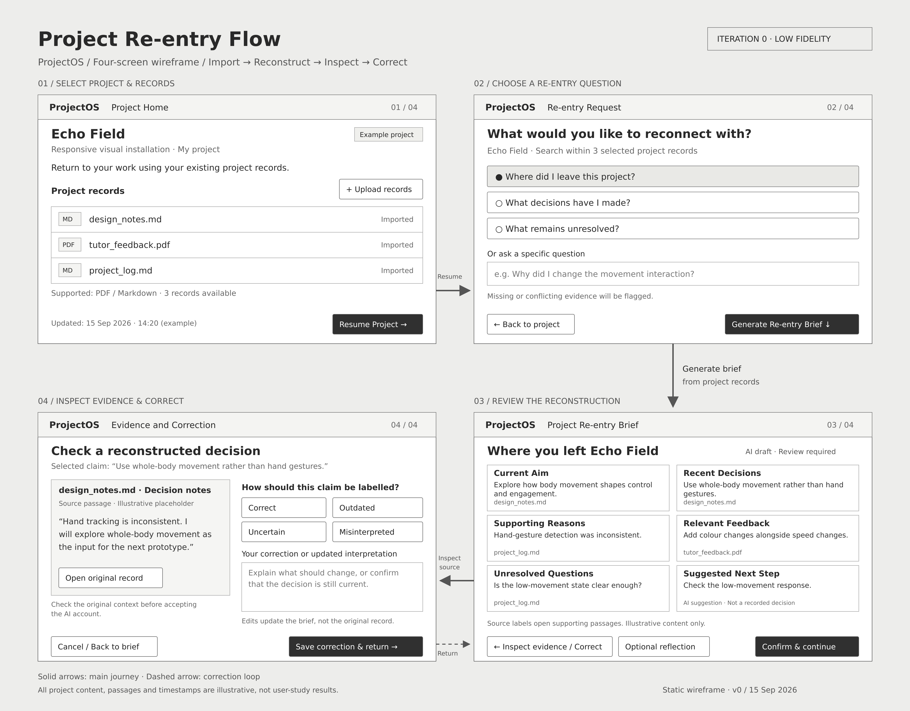

# ProjectOS

**A source-grounded, correctable brief for returning to a creative project.**

ProjectOS is an MSc research prototype that helps creative students revisit a project after an interruption. It retrieves evidence from existing project records and organises it into a six-section Project Re-entry Brief, with short AI-generated summaries and visible supporting excerpts. Users can inspect the evidence and confirm, correct or reject reconstructed project states. The current prototype runs locally through Streamlit using a prepared Echo Field demonstration archive; summary generation sends selected excerpts to the OpenAI API.

## Problem and motivation

Creative projects accumulate goals, experiments, feedback, abandoned ideas and decisions across many files. Returning after a break involves more than finding a document: the practitioner needs to reconstruct what changed, which direction is current, what remains unresolved and what to do next. Relevant text can describe an earlier stage of the project, so retrieving a similar passage does not by itself establish the current state.

## Research focus

> How can a source-grounded and correctable Project Re-entry Brief support creative students in reconstructing project state and deciding what to do next after an interruption?

The research examines evidence inspection, uncertainty, user judgement and the effort involved in reviewing an AI interpretation. It does not yet establish improvements in creativity, productivity or long-term project outcomes.

## Relationship to general-purpose AI chat tools

ProjectOS uses a fixed project re-entry workflow rather than an open-ended conversation. Its design brings together six recurring project questions, source excerpts and a persistent review history. Corrections appear as the user's current understanding while the original records remain available. These are the prototype's design priorities, not a claim that general-purpose AI tools cannot support similar tasks or that ProjectOS has demonstrated superior performance.

## Current prototype workflow

1. Launch the application and choose Development mode, or start a Participant study session with an anonymous code.
2. The application loads the prepared `sample_echo_field` archive and creates a local semantic index.
3. Generate the six-section brief. Each section receives up to two evidence excerpts and a structured summary.
4. Open the supporting records to inspect the basis of an interpretation.
5. Confirm, correct or reject a section, or mark an evidence item as belonging to an older direction.
6. Review actions are saved locally and restored when the same development or participant context is reopened.

There is currently no project picker, file-upload interface, account system or unrestricted chat. Participant codes separate local review files; they are not authentication or access control.

### Six Re-entry Brief sections

| Section | Purpose |
| --- | --- |
| Current intention | Reconstruct the project's current aim. |
| What changed and why | Revisit documented changes and their reasons. |
| Current versus superseded directions | Separate the present direction from earlier approaches. |
| Relevant feedback | Recall feedback and any documented response. |
| Unresolved tensions | Identify questions or limitations that may still need attention. |
| Possible next action | Surface a documented next step for the user to assess. |

## Evidence retrieval and user review

The loader supports Markdown, UTF-8 text and text-based PDFs. It retains relative source paths, file types and directory categories. Documents are split into overlapping chunks of up to 120 whitespace-separated words, with a 30-word overlap. The demonstration archive currently produces 12 chunks from four Markdown documents.

Sentence Transformers creates normalised `all-MiniLM-L6-v2` embeddings. Retrieval uses NumPy similarity ranking, section-specific queries, category filtering and chunk deduplication. Each brief section contains at most two evidence items. The LLM returns a structured summary, support status, project-state classification, source numbers and an assessment note; local validation checks the output structure and source-number bounds.

**Semantic similarity is not factual confidence. Generated summaries are provisional.** A valid citation number does not prove that the interpretation is correct. The retrieval layer's `supported` flag means evidence items were selected; it is separate from the LLM's assessment and from the user's review.

Review events support `confirm`, `correct`, `reject` and `mark_superseded`. They are appended to a local JSON history without rewriting source documents. User corrections are displayed separately from the generated interpretation. Development and participant histories live under `data/reviews/`, which is excluded from Git.

## Current features

- Local document loading, overlapping chunks and semantic retrieval.
- Six structured sections with inspectable source excerpts.
- OpenAI summary generation with Pydantic structured output and insufficient-evidence handling.
- Streamlit controls for confirmation, correction, rejection and older-evidence marking.
- Persistent review events and separate local files for participant codes.
- Cached retrieval resources and generated summaries during application use.
- Unit tests, a small retrieval evaluation set, design decisions and draft study materials.

## Technology stack

Python 3.11 is the tested environment. Direct dependencies are pinned in [requirements.txt](requirements.txt).

| Component | Library |
| --- | --- |
| Interface and application state | Streamlit |
| Local embeddings | Sentence Transformers |
| Similarity calculations | NumPy |
| PDF text extraction | pypdf |
| Summary API client | OpenAI Python SDK |
| Structured summary schema | Pydantic |
| Automated tests | pytest |

The prototype does not require a vector database or a separate web backend.

## Repository structure

```text
ProjectOS/
├── src/                      # Retrieval, brief, summary, review and UI modules
├── tests/                    # Unit tests and retrieval evaluation questions
├── data/demo_projects/       # Prepared Echo Field demonstration records
├── project_knowledge/
│   ├── current_state/        # Planning and evaluation documents
│   ├── decisions/            # Design and technical decisions
│   ├── process/daily_logs/   # Development history
│   ├── feedback/user_testing/iteration_1/
│   │                         # Blank study materials, not participant responses
│   └── research/             # Literature notes; downloaded PDFs excluded
├── research/                 # Earlier literature-note tree, retained for provenance
├── outputs/                  # Inspected demo image, wireframe and technical results
├── report/drafts/            # Design and implementation writing
├── requirements.txt
├── pytest.ini
└── README.md
```

Historical records describe the prototype as it existed at the time. Some planning files remain empty placeholders, and the two literature-note trees contain duplicate material retained from development. Ignored local files may be present in a working copy but are not part of the repository.

## Installation

Use Python 3.11 and a dedicated environment. From Windows Command Prompt or Miniconda Prompt, a new environment can be prepared with:

```bat
conda create -n projectos python=3.11
conda activate projectos
cd /d C:\Users\1\Desktop\ProjectOS
python -m pip install -r requirements.txt
python -m pip check
```

If the `projectos` environment already exists, activate it instead of creating it again. Other machines should use their own checkout and Conda installation paths. The first retrieval run may download the embedding model; subsequent runs can use the local model cache. Generating summaries requires network access and an OpenAI API account with access to the configured model, and may incur API charges.

## Environment variables

| Variable | Purpose |
| --- | --- |
| `OPENAI_API_KEY` | Required for summary generation. Supply it only through the environment of the process launching Streamlit. |
| `PROJECTOS_SUMMARY_MODEL` | Optional model override; the current source default is `gpt-6-luna`. The selected model must support the API options used in `src/llm_summarizer.py`. |

Configure the API key privately in the launching environment. No key value is provided in this document. The application does not load `.env` or Streamlit secrets files. Do not put a key in source code, documentation, screenshots or Git commits. API model access depends on the account; this repository does not guarantee that its default model is available to every user.

To check presence without printing the key:

```bat
python -c "import os; print('OPENAI_API_KEY configured' if os.getenv('OPENAI_API_KEY') else 'OPENAI_API_KEY missing')"
```

## Run the Streamlit prototype

For the existing Windows installation, use **Command Prompt**, not PowerShell, for these commands:

```bat
call C:\Users\1\miniconda3\Scripts\activate.bat projectos
cd /d C:\Users\1\Desktop\ProjectOS
python -m streamlit run src/streamlit_app.py
```

Open the local URL printed by Streamlit. Development mode is sufficient for a demonstration. The application loads records from `data/demo_projects/sample_echo_field/`; it does not index this repository's research notes or downloaded papers. Without an API key, evidence inspection is available, but new LLM summaries cannot be generated. Review controls are shown when a summary or a saved user correction is available.

## Run tests and checks

After activating `projectos`, run from the repository root:

```bat
python -m py_compile src/streamlit_app.py
python -m pytest tests/test_reentry_brief.py tests/test_review_store.py tests/test_llm_summarizer.py -v
python -m pip check
```

`pytest.ini` adds `src` to pytest's import path, so a separate `PYTHONPATH` setting is unnecessary. The 23 existing tests cover section structure, evidence metadata, review storage and restoration, summary validation and an empty-evidence fallback. They do not make live OpenAI requests or load an embedding model, although collection imports the installed dependencies. They are not end-to-end interface or factual-accuracy tests.

The separate retrieval evaluation can be run with:

```bat
python src/evaluate_retrieval.py
```

It loads the embedding model and evaluates six developer-authored queries. The [recorded Iteration 0 baseline](outputs/test_results/day_03_retrieval_results.md) reported Hit@1 of 4/6 and Hit@3 of 6/6 on the demonstration archive. These historical figures are not a general accuracy score or evidence of user benefit.

## Current prototype status

The repository contains an Iteration 1 research prototype with summary generation and participant review isolation. The latest development record documents technical rehearsals and preparation of the study pack; a complete timed rehearsal and formal participant evaluation remain follow-up work. This is a local demonstration and research implementation, not a production service.

## Research and evaluation plan

The planned study involves approximately five to eight adult creative students or practitioners, using a common prepared archive for the first iteration. Tasks examine understanding of current and superseded directions, evidence inspection, correction or rejection, unresolved issues and the proposed next action. Observations, task responses, questionnaire ratings and short interviews will inform the next iteration.

The [research questions](project_knowledge/feedback/user_testing/iteration_1/research_questions.md), [test protocol](project_knowledge/feedback/user_testing/iteration_1/participant_test_protocol.md) and [questionnaire and interview template](project_knowledge/feedback/user_testing/iteration_1/post_test_questionnaire_and_interview.md) are available for review. The information sheet and consent form are **blank drafts**, with identity, contact, withdrawal and retention fields to complete privately before use. Session-duration estimates also need reconciliation through a full rehearsal. No completed participant responses are published here.

## Limitations

- Evaluation is currently based on one small prepared archive. Broader project transfer and user benefit remain unverified.
- Retrieval does not explicitly model chronology or parse state metadata. Related passages can still mix resolved issues, current blockers and future work. No PDF OCR is implemented.
- Generated summaries can omit or misinterpret evidence. Source-number checks do not verify factual entailment.
- Reviews persist, but exact generated-summary snapshots are not durably linked to review events. A regenerated section can inherit an earlier review status.
- A confirmation following a correction currently removes that correction from the active display, while retaining the historical event.
- In participant mode, partial generation success or invalidated evidence can leave missing summaries without a direct retry button. This is a known issue to resolve before a formal study.
- Source-file edits do not automatically invalidate the cached retrieval resources. Restart the local application after changing the demonstration archive.
- JSON review storage is intended for supervised local use; it has no authentication or concurrent-write coordination. Review-file isolation does not make this a secure multi-user service.

## Privacy and repository contents

**Participant research data is not included in the repository.** Public materials consist of code, prepared demonstration records, development documentation, blank research templates and inspected prototype visuals. The Echo Field records are a prepared archive, not raw ProjectOS participant data.

Local review histories, participant responses, signed consent forms, recordings, transcripts, private meeting attachments, downloaded academic PDFs and unapproved screenshots are excluded through `.gitignore`. Original local records are retained. New study outputs should be stored in ignored private directories, never entered into the public blank templates. Ignore rules do not anonymise a file or protect a file that has already been committed; inspect the staged files before publishing.

Document loading and embedding-based retrieval run locally. On generation, selected excerpts are sent to the OpenAI API with `store=False`; this is not a claim of zero provider-side retention. Do not use personal or confidential material in the demonstration archive. Never publish API credentials or participant data.

## Screenshots and design artifacts

The following inspected images show historical development, not the latest interface or participant study results.


*Earlier command-line prototype: a developer-authored correction remains separate from retrieved evidence.*



*Early design exploration. Upload, project-selection and navigation controls shown in the wireframe are not implemented in the current application.*

## Author and course context

**Zeno Zhang**\
MSc Creative Computing\
UAL Creative Computing Institute\
2026

ProjectOS is an individual graduation research project at the University of the Arts London. It combines software prototyping with reflective design documentation and a planned formative study.

## Licensing

This repository uses mixed licensing. Source code created by Zeno Zhang in `src/` and `tests/` is licensed under the [MIT License](LICENSE). The standard MIT text is available from the [Open Source Initiative](https://opensource.org/license/mit).

Research writing, research materials, `project_knowledge/`, interface screenshots and other original documentation and assets are **Copyright © 2026 Zeno Zhang. All Rights Reserved.** They are not covered by the MIT grant. Third-party libraries, models and dependencies remain under their respective licences. See [LICENSE](LICENSE) for the full scope and terms.

Downloaded research papers are excluded, while literature notes retain their source references.
